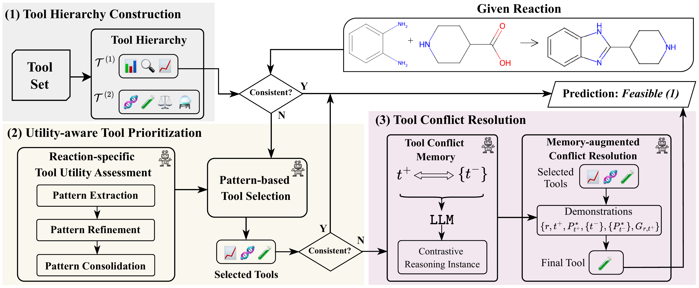

# ARMOR Pipeline

This is the official code for the paper: **ARMOR: An Agentic Framework for Reaction Feasibility Prediction via Adaptive Utility-aware Multi-tool Reasoning**.

## Overview

A three-module pipeline for chemistry reaction feasibility prediction:

1. **Module 1: Tool Hierarchy Construction** — Build a two-tier tool hierarchy; split samples into unanimous / disagreement sets.
2. **Module 2: Utility-Aware Tool Prioritization** — Extract and refine per-tool reaction rules; match rules against disagreement samples.
3. **Module 3: Tool Conflict Resolution** — Build guided demonstrations; use FAISS + LLM to resolve tool conflicts on the test set.

<a href="ARMOR.pdf"></a>

> **Note:** "rule" in this repository corresponds to "pattern" in the paper.

---

## Data

All data is under `data/`.

### Datasets

We release the reactions and ground-truth labels of the three datasets used in the paper. Each dataset has a `dev.jsonl` and a `test.jsonl`, with one reaction per line:

```json
{"idx": 0, "reactants": "<SMILES>", "product": "<SMILES>", "label": "1"}
```

| Dataset | Directory | Dev | Test | Source |
|---|---|---|---|---|
| FREA | `data/FREA/` | 3,000 feasible + 3,000 infeasible | 3,000 feasible + 3,000 infeasible | Yu et al. [1] |
| OChem-Cand | `data/OChem-Cand/` | 1,500 feasible + 1,500 infeasible | 1,500 feasible + 1,500 infeasible | USPTO reactions, with the candidate products of Coley et al. [2] as infeasible reactions |
| RxnEBM-Prop | `data/RxnEBM-Prop/` | 1,500 feasible + 1,500 infeasible | 1,500 feasible + 1,500 infeasible | USPTO-50K reactions, with the NeuralSym proposals released by Lin et al. [3] as infeasible reactions |

- `idx`: integer sample index, starting from 0
- `reactants` / `product`: SMILES strings in Kekulé form
- `label`: `"1"` for feasible, `"0"` for infeasible

Within each file the feasible reactions come first.

If you use these datasets, please also cite their sources:

1. Botao Yu, Bo Zhou, Daniel Adu-Ampratwum, Frazier N. Baker, Ziru Chen, Reza Averly, Ye Liu, Wenhao Gao, Xia Ning, Huan Sun. FREA: A Multi-Source Expert Benchmark for Reaction Feasibility Verification. arXiv:2610.06614, 2026.
2. Connor W. Coley, Regina Barzilay, Tommi S. Jaakkola, William H. Green, Klavs F. Jensen. Prediction of Organic Reaction Outcomes Using Machine Learning. ACS Central Science, 3(5):434–443, 2017. https://doi.org/10.1021/acscentsci.7b00064
3. Min Htoo Lin, Zhengkai Tu, Connor W. Coley. Improving the performance of models for one-step retrosynthesis through re-ranking. Journal of Cheminformatics, 14:15, 2022. https://doi.org/10.1186/s13321-022-00594-8

### Tool Predictions

ARMOR takes as input the predictions of each tool on the dev and test reactions. To run ARMOR on a dataset, first run your own tools on its reactions, then write each tool's predictions as a JSONL file where every line is:

```json
{"idx": 0, "reactants": "<SMILES>", "product": "<SMILES>", "label": "1", "tool_prediction": "1"}
```

- `idx`, `reactants`, `product`, `label`: as in the dataset files, with `idx` consistent across all tool files
- `tool_prediction`: the tool's prediction (`"0"`, `"1"`, or `"NA"` for abstention)

`data/demo/` is a demo in this format that runs out of the box: 100 dev and 100 test reactions sampled from FREA (50 feasible + 50 infeasible each), with the predictions of the 13 tools used in the paper, one file per tool.

**Input:** the pipeline reads `data/demo/dev/` and `data/demo/test/`. To run on other reactions or tools, replace the files there with one file per tool, named `{tool_name}.jsonl`, and update `tool_list` in `config.yaml` accordingly.

**Output:** `evaluation/predictions_ARMOR.jsonl` — per-sample final predictions, alongside the metrics table printed by `eval_test.py`.

---

## Environment Setup

**Python:** 3.10+

**Step 1 — Install PyTorch** (choose the command matching your CUDA version from [pytorch.org](https://pytorch.org/get-started/locally/)):

```bash
# Example: CUDA 12.4
pip install torch==2.4.1 --index-url https://download.pytorch.org/whl/cu124
```

**Step 2 — Install remaining dependencies:**

```bash
pip install -r requirements.txt
```

> `requirements.txt` lists `faiss-gpu` by default. Replace with `faiss-cpu` if running on CPU only.

**Step 3 — Download the LLM and set the model path** in `config.yaml`.

The pipeline uses [T3Q-qwen2.5-14b-v1.0-e3](https://huggingface.co/JungZoona/T3Q-qwen2.5-14b-v1.0-e3) as the LLM. Download it from HuggingFace and set the local path:

```yaml
model_paths:
  t3q: "/path/to/T3Q-qwen2.5-14b-v1.0-e3"
```

---

## Configuration

Edit `config.yaml` before running. Key parameters:

| Key | Default | Description |
|---|---|---|
| `llm` | `t3q` | LLM used throughout the pipeline |
| `model_paths.t3q` | `""` | Path to T3Q model directory |
| `hierarchy.p` | `0.25` | Fraction of tools in tier 1 |
| `subset.N_list` | `[5,10,25,45]` | Subset sizes for rule extraction |
| `subset.M` | `100` | Number of subsets per (tool, N) |
| `rule_filtering.tau_1` | `1.0` | Min align_score |
| `rule_filtering.tau_2` | `1.0` | Min coverage_score |
| `ruleset.tau_3` | `0.5` | Min rule confidence |
| `ruleset.top_p` | `5` | Max rules per tool |
| `selection.L` | `5` | Top-L candidates shown to LLM |
| `selection.top_k` | `8` | FAISS-retrieved reference reactions |
| `cuda_visible_devices` | `"0"` | GPU device(s) for LLM inference |

---

## Running the Pipeline

Run each module in order from the repository root:

```bash
# Module 1: build tool hierarchy and split dev/test samples
bash run_module1.sh

# Module 2: extract and match per-tool rules, prepare candidates
bash run_module2.sh

# Module 3: build memory and resolve test conflicts via LLM
bash run_module3.sh

# Evaluation: compute metrics and save final predictions
bash run_eval.sh
```

The four scripts must be run in order. See each script for per-step details.

---

## Repository Structure

```
ARMOR/
├── config.yaml
├── requirements.txt
├── run_module1.sh
├── run_module2.sh
├── run_module3.sh
├── run_eval.sh
├── utils/
│   └── utils.py
├── data/
│   ├── FREA/           dev.jsonl, test.jsonl (reactions and labels)
│   ├── OChem-Cand/     dev.jsonl, test.jsonl (reactions and labels)
│   ├── RxnEBM-Prop/    dev.jsonl, test.jsonl (reactions and labels)
│   └── demo/           small runnable demo with tool predictions
│       ├── dev/        {tool}.jsonl for each tool
│       └── test/       {tool}.jsonl for each tool
├── module1_tool_hierarchy_construction/
│   ├── define_hierarchy.py
│   └── find_test_disagreement.py
│   (splits/ and test_splits/ are created at runtime)
├── module2_utility_aware_tool_prioritization/
│   ├── reaction_specific_tool_utility_assessment/
│   │   ├── pattern_extraction/
│   │   │   ├── subset_construction.py
│   │   │   └── rule_detection.py
│   │   ├── pattern_refinement/
│   │   │   ├── rule_verify.py
│   │   │   ├── validate_rules.py
│   │   │   └── rule_filtering.py
│   │   └── pattern_consolidation/
│   │       ├── aggregation.py
│   │       ├── prune_rules.py
│   │       ├── compute_rule_stats.py
│   │       └── generate_ruleset.py
│   └── pattern_based_tool_selection/
│       ├── rule_matching/
│       │   ├── match_rules.py
│       │   └── aggregate_matching.py
│       └── candidate_preparation/
│           └── preprocess.py
├── module3_tool_conflict_resolution/
│   ├── tool_conflict_memory/
│   │   └── build_memory.py
│   └── memory_augmented_conflict_resolution/
│       └── conflict_resolution.py
└── evaluation/
    └── eval_test.py
```
